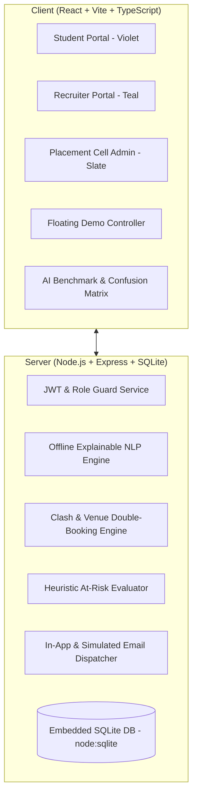

# CAMPUSLINK 🚀
### AI-Powered Campus-to-Corporate Placement Management & Analytics Platform

**CAMPUSLINK** is a full-stack campus recruitment and placement management prototype featuring an **offline explainable AI matching engine**, multi-tenant architecture, automated conflict detection, and simulated corporate communication outboxes.

---

## 🏗️ Architecture & Tech Stack



- **Frontend**: React 18, Vite, TypeScript, Tailwind CSS, Framer Motion (animated match-rings, glowing pipeline steppers, micro-interactions), Recharts (funnels, branch conversion, CTC distribution), Lucide Icons, Canvas-Confetti.
- **Backend**: Node.js + Express, embedded high-performance SQLite (`node:sqlite` DatabaseSync with WAL journal mode), bcryptjs password hashing, JWT stateless authentication.
- **Explainable AI Engine**: 100% offline rule + NLP hybrid. Normalizes aliases (e.g. `py3`, `python3` $\rightarrow$ Python, `reactjs` $\rightarrow$ React) using a master skills dictionary, computes exact skill match %, readiness levels, plain-English explanations, at-risk flags, and drive scheduling clashes.

---

## ⚡ Quick Start (1 Command Install, Seed, & Run)

### 1. Installation
```bash
npm run install:all
```

### 2. Seed Database (Creates 60 Students, 5 Companies, 6 Vacancies, & Demo Scenarios)
```bash
npm run seed
```

### 3. Run AI Test Suite & Evaluation Benchmark
```bash
npm run test:ai
```

### 4. Start Full-Stack App (Backend on 5000, Frontend on 5173)
```bash
# Terminal 1: Backend
npm run server

# Terminal 2: Frontend
npm run client
```

---

## 🔑 Demo Credentials & Scenarios

| Role / Persona | Login Email / Reg No | Password | Key Feature / Scenario |
| :--- | :--- | :--- | :--- |
| **Student (Top Candidate)** | Reg: `2023CSE042` / `priya.sharma@college.edu` | `password123` | Has **Offer Released** from Apex Innovations (8.92 CGPA, 0 backlogs). |
| **Student (Clash Demo)** | Reg: `2023CSE011` / `aarav.patel@college.edu` | `password123` | Scheduled in **2 drives on the same date/time** (2026-10-15 10:00 AM) to demo Clash Detection. |
| **Student (Backlog Demo)** | Reg: `2023MECH071` / `vikram.singh@college.edu` | `password123` | Has **3 active backlogs**; triggers clear corporate backlog block message on zero-backlog jobs. |
| **Student (Pre-Final Year)** | Reg: `2024ECE015` / `ananya.deshmukh@college.edu` | `password123` | 3rd-year student with UI/UX & Frontend skillset. |
| **Recruiter (Apex Innovations)** | `careers@apexinnovations.com` | `recruiter123` | Full Stack Developer, Data Analyst vacancies. |
| **Recruiter (CloudScale Systems)** | `hiring@cloudscale.io` | `recruiter123` | Zero-backlog Cloud & DevOps vacancies. |
| **Placement Cell Admin** | `admin@campuslink.edu` | `admin123` | Full administrative control, student master list, audit logs, settings, and clash center. |

---

## ⏱️ 5-Minute End-to-End Demo Walkthrough Guide

Use the **floating "Demo Controls" panel** at the bottom-right of the screen to fast-forward any recruitment stage:

1. **AI Skill Extraction & Student Profiling**:
   - Log in as **Priya Sharma** (`2023CSE042`).
   - Navigate to **CV & Profile**. Notice master data (Reg No, CGPA, Branch) is verified and read-only.
   - Click one of the resume preset buttons (or upload a file). The AI Engine tokenizes text and extracts skills into interactive chips. Confirm the skills.

2. **Job Discovery & Explainable AI Match**:
   - Go to **My Jobs**. Observe animated match score rings (emerald for Highly Employable, violet for Ready, amber for Developing).
   - Click on **Full Stack Software Developer**. Inspect the plain-English explanation, matched skills, and skill gap chips.

3. **Strict 3-Step Apply Rules Verification**:
   - Click **Apply**.
   - Step 1: Checks $\text{Match } \ge 60\%$.
   - Step 2: Types Reg No `2023CSE042` to verify identity against master records.
   - Step 3: Checks backlog rule.
   - Click submit $\rightarrow$ Application submitted with attached AI match score!

4. **Testing Backlog-Blocked Application**:
   - Use Demo Controls to switch to **Vikram Singh** (`2023MECH071` - 3 Backlogs).
   - Open **CloudScale Systems (Cloud & DevOps Engineer)**.
   - Notice the Apply button is disabled with the exact message: *"You have 3 active backlog(s). This job does not allow backlogs."*

5. **Recruiter Review & Applications Unlock**:
   - Use Demo Controls to switch to **Apex Innovations** (`careers@apexinnovations.com`).
   - Go to **Applications**. Notice if drive is active, it shows: *"Applications open after <date>. Applied so far: N"*.
   - In Demo Controls, click **"Advance date to after close date"**.
   - Applications immediately unlock, revealing the ranked candidate table with Match %, CGPA, and Drawer inspection!

6. **Round Grading & Clash Detection**:
   - Go to **Rounds & Results**. Grade candidates with Pass/Fail toggles.
   - Click **Submit Results**. A confirmation popup displays: *"X move forward, Y rejected. Confirm?"*.
   - Confirm submission $\rightarrow$ Advancing candidates triggers automated clash check warnings (e.g. Aarav Patel double booking).

7. **Offer Release & Acceptance with Confetti**:
   - Go to **Offers** in Recruiter portal and release an offer letter to a selected finalist.
   - Switch back to the student login $\rightarrow$ Navigate to **Offers**.
   - Click **Accept Offer** $\rightarrow$ Triggers confetti burst and automatically closes other pending offers under the One-Offer policy!

8. **Institutional Analytics & AI Benchmark Benchmark**:
   - Open **Placement Cell Portal** to inspect Branch Conversion bar charts, CTC distribution, and Audit Log history.
   - Click **AI Evaluation Benchmark** in top navigation to review the 4x4 Confusion Matrix, Precision, Recall, F1 metrics, and test custom resumes in the Live Playground.

---

## 🌐 Multi-Campus & Multi-Tenant Scalability Architecture

CAMPUSLINK is architected for zero-friction scaling from a single college to a multi-university network:
- **Tenant Isolation**: Every database table (`student_master`, `company`, `vacancy`, `application`, `settings`, `audit_log`) includes a composite indexed `campus_id` / `tenant_id` column.
- **Independent College Policies**: Each campus customizes its own minimum match score (e.g. 60% vs 70%), master skills list, and one-offer vs dream-offer rules.
- **Enterprise Multi-College Hiring**: Corporate recruiters can publish vacancies across multiple affiliated campuses simultaneously with unified grading dashboards.
